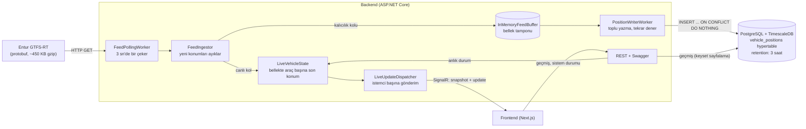

# Canlı Araç Takip Platformu

Norveç'in ulusal toplu taşıma platformu **Entur**'un GTFS-Realtime *Vehicle Positions* akışını 3 saniyede bir okuyan, son 3 saatin
konumlarını **PostgreSQL + TimescaleDB**'de saklayan ve araçları **SignalR (WebSocket)** üzerinden canlı haritaya yayınlayan bir
platform. Backend ASP.NET Core (.NET 10), frontend Next.js (App Router).

🎬 **Tanıtım videosu:** https://youtu.be/lnRn4va51UQ

---

## İçindekiler

- [Teknoloji yığını](#teknoloji-yığını)
- [Çalıştırma](#çalıştırma)
- [Mimari ve veri akışı](#mimari-ve-veri-akışı)
- [Bileşenlerin sorumlulukları](#bileşenlerin-sorumlulukları)
- [Dayanıklılık: her senaryoda verinin akıbeti](#dayanıklılık-her-senaryoda-verinin-akıbeti)
- [Veri akışında yapılan gözlemler](#veri-akışında-yapılan-gözlemler)
- [Soruların cevapları](#soruların-cevapları)
- [Dokümanlar](#dokümanlar)

## Teknoloji yığını

| Katman | Kullanılanlar |
|---|---|
| Backend | ASP.NET Core (.NET 10), EF Core + Npgsql, SignalR, Google.Protobuf, Swagger (OpenAPI), xUnit |
| Veritabanı | PostgreSQL 17 + TimescaleDB 2.30 (hypertable, retention policy) |
| Frontend | Next.js 16 (App Router), React 19, TypeScript (strict), TanStack Query, Zustand, zod, next-intl, Tailwind CSS + shadcn/ui, MapLibre GL JS (OpenFreeMap altlık) |
| Çalıştırma | Docker Compose |

## Çalıştırma

**Gereksinim:** Docker Desktop (Compose dahil).

```bash
git clone https://github.com/onreyl/canli-arac-takip.git
cd canli-arac-takip
docker compose up -d --build
```

Ayar dosyası oluşturmak **gerekmez**: tüm değişkenlerin yerel geliştirme varsayılanları `docker-compose.yml`'de tanımlı. Değiştirmek
istersen `.env.example`'ı `.env` adıyla kopyalayıp düzenle (`.env` git'e girmez).

| Adres | Ne |
|---|---|
| http://localhost:3000 | Arayüz (`/tr`, `/en`; sistem durumu: `/tr/status`) |
| http://localhost:5295/swagger | REST API ve Swagger |
| http://localhost:5295/health | Sağlık durumu (DB + veri toplama); `/health/live` sadece süreç ayakta mı |
| `ws://localhost:5295/hubs/vehicles` | SignalR hub (canlı yayın) |

Backend açılır açılmaz migration'ları kendisi uygular ve veri toplamaya başlar.

**Ayarlar:**
- `.env.example`: veritabanı adı, kullanıcı, şifre ve host portu (`POSTGRES_DB`, `POSTGRES_USER`, `POSTGRES_PASSWORD`, `POSTGRES_PORT`).
- Saklama ayarları ortam değişkeniyle değiştirilebilir (varsayılanlar `appsettings.json` ile aynı):
  `RETENTION` = **3 saat**, `CHUNK_INTERVAL` = **15 dk**, `RETENTION_CHECK_INTERVAL` = 1 dk. Kaynak adresi: `ENTUR_URL`.
  Silmeyi 3 saat beklemeden görmek için: [docs/resilience-tests.md → Test 7](docs/resilience-tests.md).

**Durdurma:**
```bash
docker compose down        # konteynerleri durdur, veriyi koru
docker compose down -v     # veritabanı verisini de sil
```

**Testler:** `dotnet test backend/tests/VehicleTracking.UnitTests` (38 birim testi).

## Mimari ve veri akışı



**Bir konumun yolculuğu:**
1. `FeedPollingWorker` 3 sn'de bir Entur'dan feed'i çeker (gzip). Protobuf, Infrastructure katmanında kendi `VehiclePosition` tipimize çevrilir.
2. `FeedIngestor` feed zamanı öncekinden yeni değilse turu atlar; yeniyse yalnızca daha önce görülmemiş `(entity_id, measured_at)`
   çiftlerini ve son 3 saatin ölçümlerini bırakır.
3. Yeni konumlar **iki kola** ayrılır:
   - **Kalıcılık kolu:** bellek tamponuna girer; `PositionWriterWorker` tek sorguda (`unnest` + `ON CONFLICT DO NOTHING`) TimescaleDB'ye
     yazar. DB yoksa aynı partiyi 1 → 10 sn artan beklemeyle tekrar dener; yazma tekrar güvenli olduğu için çift kayıt oluşmaz.
   - **Canlı kol:** `LiveVehicleState`'teki araç başına son konum güncellenir, `LiveUpdateDispatcher` değişiklikleri her istemciye
     kendi gönderim döngüsüyle yollar. **Bu kol veritabanına bağlı değildir:** DB kapalıyken de harita akar.
4. Yeni bağlanan (ya da yeniden bağlanan) istemci önce tam görüntüyü (`snapshot`), sonra değişiklikleri (`update`) alır.
5. Silme uygulama kodunda değil: TimescaleDB'nin retention policy'si süresi dolan chunk'ları bütün olarak atar.

Ayrıntı: [docs/architecture.md](docs/architecture.md).

## Bileşenlerin sorumlulukları

### Backend (`backend/src`, Clean Architecture, bağımlılık içe doğru)

| Proje | Sorumluluk ve kilit sınıflar |
|---|---|
| `VehicleTracking.Domain` | `VehiclePosition` (değişmez kayıt) ve kuralları: `IsDeadRun`, `IsWithinRetention`. Hiçbir şeye bağımlı değil. |
| `VehicleTracking.Application` | Arayüzler (`IFeedSource`, `IFeedBuffer`, `IPositionWriter`, `IVehicleHistoryReader`, `ILiveUpdatePublisher`) ve karar mantığı: `FeedIngestor` (hangi konum yeni?), `LiveVehicleState` (canlı durum), `IngestionMetrics` (sistem durumu sayaçları). |
| `VehicleTracking.Infrastructure` | `EnturFeedSource` + `GtfsRealtimeMapper` (HTTP + protobuf → domain; protobuf tipleri `internal`, dışarı sızmaz), `NpgsqlPositionWriter` (toplu yazma), `EfVehicleHistoryReader` (keyset sayfalı geçmiş), `DatabaseInitializer` (migration + hypertable + retention policy), `InMemoryFeedBuffer`. |
| `VehicleTracking.Api` | Host: `FeedPollingWorker` ve `PositionWriterWorker` (arka plan servisleri), `VehiclesHub` + `LiveUpdateDispatcher` + `LiveClientFeed` (SignalR, yavaş istemci için birleştirme), `VehiclesController` ve `SystemController` (REST), health check'ler, `DatabaseUnavailableExceptionHandler` (DB yokken 503). |

**REST uçları:** `GET /api/vehicles` (anlık durum), `GET /api/vehicles/{id}/history?from&to&pageSize&cursor` (son 3 saat, keyset
sayfalı), `GET /api/system/status` (son başarılı okuma, son 1 saatte yazılan, başarısız deneme, bağlı istemci + teşhis sayaçları).

### Frontend (`frontend/src`, feature bazlı)

| Klasör | Sorumluluk ve kilit dosyalar |
|---|---|
| `features/live-map` | Canlı harita: `liveVehiclesStore.ts` (Zustand), `useLiveVehicleStream.ts` (hub → store), `LiveMap.tsx` (MapLibre, tek GeoJSON katmanı), `ConnectionBadge.tsx`, `VehicleFilterPanel.tsx` + `vehicleFilter.ts` (arama, URL'de filtre). |
| `features/vehicle-detail` | `VehicleDetailPanel.tsx` (canlı bilgiler + geçmiş listesi), `useVehicleHistory.ts` (TanStack `useInfiniteQuery`, imleçli sayfalama, haritada iz). |
| `features/system-status` | `SystemStatusPanel.tsx` (5 sn'de bir yenilenen sayaçlar). |
| `shared/` | `realtime/vehicleHub.ts` (SignalR bağlantısı, otomatik yeniden bağlanma), `api/http.ts` + `contracts/*.ts` (zod ile doğrulanan REST), `ui/LocaleSwitcher.tsx`. |
| `app/[locale]`, `i18n/`, `messages/` | İnce sayfa dosyaları; next-intl ile TR/EN (koda gömülü metin yok). |

Feature'lar birbirini yalnızca `index.ts` üzerinden kullanır. Kararların gerekçeleri: [docs/frontend-decisions.md](docs/frontend-decisions.md).

## Dayanıklılık: her senaryoda verinin akıbeti

| Senaryo | Ne olur | Ne kaybolur | Ne korunur, neden |
|---|---|---|---|
| **Kaynak birkaç dakika erişilemez** | Döngü çökmez; başarısız okuma sayılır, `/health` "Degraded" olur, kaynak dönünce toplama kendiliğinden devam eder. | Kesinti süresindeki ara konumlar. **Önlenemez:** GTFS-RT geçmiş tutmaz, okunmayan an geri gelmez. | Kaynak dönünce ilk okumada her aracın son konumu gelir; canlı durum hemen doğrulanır. |
| **Bozuk yanıt** (protobuf çözülemiyor / HTTP hatası) | Tur atlanır, başarısız okuma sayılır. | O turun verisi (kaynak kesintisiyle aynı). | Bozuk veri DB'ye ve canlı duruma hiç girmez. |
| **DB birkaç dakika kapalı** | Toplama ve **canlı harita devam eder**. Partiler bellek tamponunda bekler, yazıcı tekrar dener. Geçmiş uç noktası 503 döner. | Yok (tampon kapasitesi ~50 dk). | DB dönünce bekleyenler yazılır; yazma idempotent, yarım kalan deneme çift kayıt üretmez. |
| **Uygulama çalışırken yeniden başlatılır** (düzgün kapanış) | Önce çekme durur, sonra yazıcı tamponu boşaltır (20 sn ≤ host 25 sn ≤ Docker 30 sn). | Uygulamanın kapalı kaldığı birkaç saniye (önlenemez, kaynak geçmiş tutmaz). | Tampondakiler yazılır; açılışta ilk okumayla canlı durum geri gelir. |
| **Ani çökme** ya da **DB kapalıyken yeniden başlatma** | Bellek tamponu kaybolur. | Tampondaki partiler: DB sağlıklıyken son birkaç saniye, DB kapalıyken birikenler. **Bilinen eksik.** | Canlı durum ilk okumada geri gelir. Önlemi: disk tamponu ya da kalıcı kuyruk (bkz. [bilinen eksikler](#e-bilinen-eksikler-daha-fazla-zaman-olsaydı)). |
| **DB ~50 dk'dan uzun kapalı** | Tampon dolar, en eski parti atılır, sayılır ve loglanır (`droppedBatchCount`). | Atılan partiler. | Çekme ve canlı yayın durmaz (tampon dolunca çekmeyi durdurmak haritayı da dondururdu). |
| **WebSocket istemcisi kopar** | Rozet "yeniden bağlanıyor" → "koptu"; harita son bilinen konumlarla kalır, otomatik yeniden bağlanır. | Yok. | Yeniden bağlanınca yeni `snapshot` elindeki listenin yerine geçer; arada kaçan önemsizdir. |
| **WebSocket istemcisi çok yavaş okur** | Yalnızca kendi gönderim döngüsü bekler; diğer istemciler ve veri toplama etkilenmez. | O istemci aynı aracın **ara** konumlarını atlar (bilinçli). | Bekleyenler araç kimliğine göre birleşir; son konum her zaman gider, bellek araç sayısıyla sınırlı. |

**Test sonuçları (22 Ekim, sabah yoğun saati 08:28-08:44 Oslo; ayrıntı ve komutlar: [docs/resilience-tests.md](docs/resilience-tests.md)):**

| Senaryo | Sonuç | Veri kaybı |
|---|---|---|
| Bozuk yanıt / HTTP hatası | Başarısız okuma sayıldı, uygulama ayakta; adres düzelince 20 sn içinde devam | Okunamayan süre (kaçınılmaz) |
| DB 3 dk kapalı | Okuma ve canlı durum devam etti; bekleyen parti 31'e çıktı, DB dönünce 5 sn'de 0; geçmiş ucu 503 | **Yok** (dakika başına satırda delik yok) |
| Uygulama yeniden başlatma | Düzgün kapanış, ~1 sn'de geri geldi | Görünür kayıp yok |
| DB kapalıyken yeniden başlatma | `Kapanışta tampon boşaltılamadı, 10 parti kayboldu.` | **10 parti** (bilinen eksik) |
| İstemci kopar | Otomatik yeniden bağlandı, yeni snapshot aldı | Yok |
| Yavaş istemci | Diğer istemci ve toplama etkilenmedi | Yok |

İstemci senaryoları tarayıcı yerine aynı SignalR protokolünü konuşan bir .NET test istemcisiyle denendi. Kaynağın tamamen erişilemez
olması (internet kesme) ve kısa saklamayla silme gösterimi (veritabanını siler) bu turda çalıştırılmadı; normal ayarla silmenin
çalıştığı 14 Ekim'de doğrulandı ([docs/observations.md](docs/observations.md)). Yavaş istemcide, yerel testte işletim sisteminin TCP
tamponları büyük olduğu için sunucu tarafı birleştirme devreye girmedi; birleştirme mantığı `LiveClientFeedTests` ile doğrulanıyor.
Bozuk yanıtta döngünün durmamasının sebebi koddan: `EnturFeedSource` çözülemeyen protobuf'u, HTTP hatasını ve zaman aşımını tek bir
`FeedUnavailableException`'a çevirir; `FeedPollingWorker` bunu yakalayıp sayar ve turu atlar; beklenmeyen hatalar da en dışta yakalanır.

## Veri akışında yapılan gözlemler

Ayrıntı ve sayılar: [docs/observations.md](docs/observations.md) (12-15 Ekim 2026).

- **Bir varlık bir araç değil.** ~8.200-8.600 varlığa karşılık ~3.300 farklı araç kimliği var: aynı araç gün içindeki her seferi
  için ayrı varlık olarak geliyor (bir araç 42 kez görüldü). → Tekrar kontrolü `(entity_id, measured_at)` ile; haritada araç başına
  tek işaret (en yeni ölçüm).
- **Feed'in yarısından fazlası saatlerce sessiz araçlar.** 13 Ekim akşamı 8.244 varlığın %56'sının son ölçümü 3 saatten eskiydi
  (bitmiş seferler son konumlarıyla listede kalıyor). → Bunlar yazılmıyor; haritada son ölçümü 5 dk'dan eski araçlar soluk ya da gizli.
- **Feed zamanı geri gidebiliyor.** 20 dk'lık ölçümde turların %15'inde feed zamanı bir öncekinden eskiydi (muhtemelen Entur'un
  arkasında birden fazla sunucu). Turların %36'sında ise feed hiç değişmemişti. → Yeni olmayan feed hiç işlenmiyor.
- **Hacmin asıl belirleyicisi "yeni konum".** Her turda tüm varlıkları yazmak saatte ~10 milyon satır olurdu; sadece yeni konumları
  yazmak ~9 kat az.
- **"Yön = 0" yanıltıcı.** 8.049 konumun 4.082'sinde yön hiç gönderilmemiş, sadece 35'i gerçekten 0; proto2'de gönderilmeyen sayı
  0 okunur. → `HasBearing` ile ayrılıyor, gönderilmeyen alanlar `null`.
- **Oslo'nun Ruter'i (RUT) ve Bergen'in Skyss'i (SKY) bu akışta yok;** sınır ötesine giden tren/otobüsler İsveç'te de görünüyor.
- **Araç tazeliği iki tepeli:** aktif araçlar 2 dk'dan sık konum gönderiyor, 2-15 dk aralığı çok az → haritadaki 5 dk "eski" eşiği.

## Soruların cevapları

### a) Saklama yaklaşımı neden bu; 3 saatten eski veri nasıl siliniyor; 10 gün olsaydı?

**Neden TimescaleDB:** veri saf zaman serisi ve sürekli akıyor (yoğun saatte saatte ~949 bin satır). Satır satır `DELETE` saatte
yaklaşık bir milyon satırı tek tek siler; PostgreSQL bunları "ölü satır" bırakır, VACUUM sürekli yük olur, tablo şişer.
TimescaleDB'de tablo bir **hypertable**: zamana göre 15 dakikalık parçalara (**chunk**) bölünür, sorgularda tek tablo gibi kullanılır.

**Silme:** açılışta `DatabaseInitializer` bir **retention policy** kurar (süre config'ten, varsayılan 3 saat). TimescaleDB'nin kendi
arka plan işi her dakika süresi dolan chunk'ı **bütün olarak atar**. Uygulama kodu silme yapmaz; yazma hep en yeni chunk'a gittiği için
silme yazmayı kilitlemez, canlı yayın zaten DB'den bağımsız. Chunk bütün atıldığı için bazı satırlar en fazla bir chunk süresi (15 dk)
fazla kalabilir; API sorguları bu yüzden yine 3 saate kırpılır. 14 Ekim'de silme işinin 71 kez hatasız çalıştığı ve sabah verisinin
otomatik silindiği görüldü.

**10 gün olsaydı:** ölçülen saatlik satır × 240 saat; disk = satır × ölçülen satır başına ~407 byte (index'ler dahil).
Hesap ve kaynak ölçümler: [docs/observations.md → Saklama 10 gün olsaydı](docs/observations.md#saklama-10-gün-olsaydı-tahmin).

| Varsayım | Satır | Disk (sıkıştırmasız) |
|---|---|---|
| Sürekli akşam hızı (~358 bin/saat) | ~86 milyon | ~35 GB |
| Sürekli yoğun saat hızı (~949 bin/saat, üst sınır) | ~228 milyon | ~93 GB |

Gerçek değer bu ikisinin arasında olmalı (gece hacmi ölçülmedi). Yaklaşımın kendisi **yine çalışır**: silme chunk düşürmek olduğu için
veri büyüdükçe pahalılaşmaz, geçmiş sorgusu `(vehicle_id, measured_at)` index'i ve zaman aralığı sayesinde sadece ilgili chunk'lara
bakar. **Değişmesi gerekenler:** TimescaleDB **sıkıştırması** (ör. birkaç saatten eski chunk'lar sütun bazlı sıkıştırılır; bu tür
tekrarlı veride kazancın büyük olması beklenir ama bu projede **ölçülmedi**), disk planlaması, daha büyük chunk aralığı (10 günde
15 dk'lık chunk ~960 parça eder; ör. 1 saatlik chunk daha uygun) ve satırı küçültmek (en büyük sütun `entity_id`, ~60 byte; bkz. e).

### b) Hangi durumlarda veri kaybı olabilir, nasıl önlendi?

**Önlenen kayıplar:**
- **DB kesintisi:** çekme ve yazma ayrı; partiler tamponda bekler, yazıcı tekrar dener. Yazma idempotent (`ON CONFLICT DO NOTHING`,
  birincil anahtar `(entity_id, measured_at)`), tekrar denemek çift kayıt üretmez.
- **Düzgün yeniden başlatma:** kapanışta önce çekme durur, sonra tampon boşaltılır; kapanış süreleri iç içe ayarlı
  (boşaltma 20 sn < host 25 sn < Docker `stop_grace_period` 30 sn). Docker'ın varsayılanı (10 sn) olsaydı tampon boşalmadan süreç öldürülürdü.
- **Canlı yayının DB'ye bağımlılığı:** yok; harita DB kapalıyken de akar.
- **İstemci kopması:** yeniden bağlanınca tam görüntü (`snapshot`); istemci arada kaçanı hesaplamak zorunda değil.
- **Bozuk veri:** çözülemeyen yanıt hiçbir yere yazılmaz; tek bir bozuk parti yazıcıyı kilitlemesin diye kalıcı veri hataları (SQLSTATE 22/23) ayrılır.

**Önlenemeyen / bilinen kayıplar (açıkça):**
- **Kaynak kesintisi ve uygulamanın kapalı kaldığı süre:** GTFS-RT yalnızca "şu anı" verir; okunmayan an geri gelmez.
- **Ani çökme (kill -9, makine kapanması):** bellek tamponundaki partiler kaybolur. DB sağlıklıyken bu genellikle son birkaç saniyedir.
- **DB kapalıyken yeniden başlatma:** tamponda biriken partiler yazılamadan kaybolur. Ayrıca açılışta DB yoksa uygulama DB gelene kadar
  bekler, o süre toplanmaz.
- **Tampon taşması:** DB ~50 dk'dan uzun kapalı kalırsa en eski partiler atılır (sayılır, loglanır).

Neden kabul edildi ve nasıl önlenirdi: [bilinen eksikler](#e-bilinen-eksikler-daha-fazla-zaman-olsaydı), [docs/known-limitations.md](docs/known-limitations.md).

### c) Canlı veri istemcide nerede tutuluyor, neden?

İki ayrı depo, çünkü iki farklı türde veri var:
- **Canlı araçlar → Zustand store** (`aracId → araç`, sürüm, bağlantı durumu). SignalR'dan sürekli itilen, uygulama boyunca yaşayan tek
  bir durum. `snapshot` store'u tamamen değiştirir, `update` ekler/siler; sürümü eski olan mesaj uygulanmaz.
- **REST'ten istenince çekilen veri (geçmiş, sistem durumu) → TanStack Query önbelleği.** Yükleniyor/hata/başarılı durumları, yeniden
  deneme ve sayfalama hazır.

Performans için harita store'a **React render'ı olmadan** doğrudan abone olur ve MapLibre kaynağını `requestAnimationFrame` ile kare
başına en fazla bir kez toplu günceller; ~3.000 aracın her değişikliği React bileşenlerini yeniden çizdirmez.

### d) Veri hacmi ve ölçülen sayılar

| Ölçüm | Değer | Kaynak / koşul |
|---|---|---|
| Yanıt boyutu | ~1,6-1,7 MB, gzip ile ~450 KB | 12-13 Ekim |
| Okuma süresi (çekme + çözme) | ortalama 251 ms, en fazla 1.651 ms | 13 Ekim 20:03-20:23 Oslo, 401 tur (keşif aracı) |
| Backend okuma döngüsü süresi (`lastFetchDurationMs`) | ortalama 199 ms (185-267 ms) | 22 Ekim 08:23-08:28 Oslo (sabah yoğun saati), Compose'la çalışan backend, 20 örnek |
| Yazılan satır / saat | **~949 bin** (yoğun saat), ~358 bin (akşam) | 14 Ekim 15:05-16:05 Oslo, gerçek backend; 13 Ekim akşam |
| 3 saatlik satır (saklama penceresi) | ~2,85 milyon (yoğun), ~1,07 milyon (akşam) | Yukarıdakinden hesap |
| Disk | satır başına ~407 byte (tablo 227 MB + index 208 MB, 1.120.117 satır) → 1 saat ~390 MB, **3 saat ~1,15 GB** (yoğun) | 14 Ekim, `hypertable_detailed_size` |
| Canlı araç sayısı | ~3.200 (akşam yoğun saati), ~2.150 (öğlen) / 3.346-3.396 (sabah yoğun saati) | 14 Ekim / 22 Ekim |
| DB'ye toplu yazma süresi (`lastWriteDurationMs`) | ortalama 74 ms (49-280 ms) | Aynı ölçüm (silme kontrolü her dakika çalışıyordu; bu 5 dk içinde chunk düşürülüp düşürülmediği ayrıca izlenmedi) |
| Geçmiş sorgusu (1 sayfa) | ~45 ms | 14 Ekim |
| Arayüzde bir güncellemenin işlenme süresi (store + GeoJSON + `setData`) | ~1-4 ms | 15 Ekim, ~2.300 araç; rozette canlı gösteriliyor |

Hacim günün saatine göre ~3 kat değişiyor; tasarım yoğun saate göre yapıldı. Yoğun saat ölçümü sırasında 70 dakikada 0 hata, 0 kayıp parti.

### e) Bilinen eksikler; daha fazla zaman olsaydı

- **Disk tamponu yok.** Ani çökmede ya da DB kapalıyken yeniden başlatmada bellek tamponundakiler kaybolur. Neden kabul edilebilir:
  GTFS-RT her okumada tam güncel durumu gönderir; uygulama açılınca canlı durum ilk okumada geri gelir, kaybolan sadece birkaç saniyelik
  ara konumlardır. Daha fazla zamanla: her yeni feed önce diske yazılıp DB'ye yazılınca silinirdi (tampon `IFeedBuffer` arkasında olduğu
  için yazıcı ve çekici değişmezdi) ya da RabbitMQ/Kafka gibi kalıcı bir kuyruk kullanılırdı.
- **Açılışta DB yoksa toplama başlamaz** (Compose'da healthcheck sayesinde ilk açılışta sorun olmaz).
- **"Son 1 saatte yazılan" sayacı bellekte;** uygulama yeniden başlayınca sıfırdan başlar.
- **Sıkıştırma ve satır boyutu:** TimescaleDB sıkıştırması açılmadı; `entity_id` (`sefer + tarih + araç`) satırın en büyük sütunu, kısa
  bir anahtarla satır başına ~60 byte kazanılırdı.
- **Yavaş istemci gerçek ağda sınırlı denendi:** birleştirme birim testli; yerelde işletim sisteminin TCP tamponları büyük olduğu için
  sunucu tarafı birleştirme ancak tamponlar dolunca devreye giriyor.
- **Kapsam dışı bırakılan artı puan maddeleri** (öncelik zorunlu maddelere verildi): Service Alerts, Trip Updates, statik GTFS ile hat/durak
  adları (şu an kimlikler gösteriliyor), Testcontainers entegrasyon testleri, frontend testleri, mimari kuralların otomatik zorlanması, JWT.
  Yapılanlar: backend birim testleri (38), health check uçları.
- **Geçmiş aralığı** serbest başlangıç/bitiş yerine hazır seçenekler (son 15 dk / 30 dk / 1 saat / 3 saat).

## Dokümanlar

| Dosya | İçerik |
|---|---|
| [docs/architecture.md](docs/architecture.md) | Mimari diyagram, bir konumun yolculuğu, katmanlar |
| [docs/observations.md](docs/observations.md) | Entur akışının gerçek davranışı, hacim ve disk ölçümleri |
| [docs/resilience-tests.md](docs/resilience-tests.md) | Dayanıklılık senaryolarını adım adım deneme talimatları |
| [docs/known-limitations.md](docs/known-limitations.md) | Bilinen eksikler, neden kabul edildikleri, nasıl önlenirdi |
| [docs/frontend-decisions.md](docs/frontend-decisions.md) | Frontend kararları ve gerekçeleri |
| [docs/requirements-map.md](docs/requirements-map.md) | Case dokümanındaki her maddenin koddaki karşılığı |
