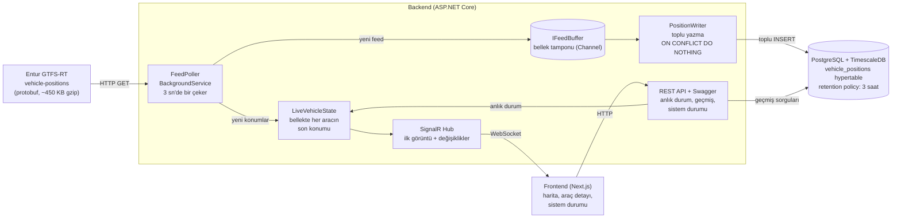

# Mimari ve Veri Akışı

## Bileşenler

## Bir konumun yolculuğu

1. **Çekme:** `FeedPoller` 3 sn'de bir Entur'dan feed'i çeker (gzip). Feed zamanı öncekinden yeni değilse turu atlar (gözlem: turların yarısı aynı, bazıları geri gidiyor).
2. **Ayıklama:** Protobuf, Infrastructure katmanında kendi `VehiclePosition` tipimize çevrilir. Sadece daha önce görülmemiş `(entity_id, measured_at)` çiftleri ve 3 saatten yeni ölçümler kalır.
3. **Tampon:** Yeni konumlar `IFeedBuffer`'a girer. DB yavaş ya da kapalıysa burada bekler. Disk tamponu kapsam dışıdır; bellek tamponunun bilinen sınırları için bkz. [docs/known-limitations.md](known-limitations.md).
4. **Kalıcı yazma:** `PositionWriter` tampondan toplu olarak okur, TimescaleDB'ye `ON CONFLICT DO NOTHING` ile yazar. Tekrar denemek güvenlidir, çift kayıt oluşmaz.
5. **Canlı yayın (DB'den bağımsız):** Aynı yeni konumlar `LiveVehicleState`'i günceller. SignalR hub bağlı istemcilere değişiklikleri yollar; yeni bağlanan istemci önce buradan tam görüntüyü alır.
6. **Silme:** TimescaleDB'nin retention policy'si 3 saati geçen chunk'ları bütün olarak atar. Uygulama kodu silme yapmaz.

## Katmanlar

| Proje | Sorumluluk | Bağımlılık |
|---|---|---|
| `VehicleTracking.Domain` | `VehiclePosition` ve kuralları | hiçbir şey |
| `VehicleTracking.Application` | Arayüzler (`IFeedSource`, `IFeedBuffer`, `IPositionWriter`, `ILiveBroadcaster`…), ayıklama akışı, sorgular | Domain |
| `VehicleTracking.Infrastructure` | Entur HTTP + protobuf, EF Core + TimescaleDB, toplu yazıcı, bellek tamponu | Application, Domain |
| `VehicleTracking.Api` | Host: REST, SignalR, arka plan servisleri, DI, Swagger | hepsi |

Protobuf tipleri Infrastructure dışına çıkmaz.
