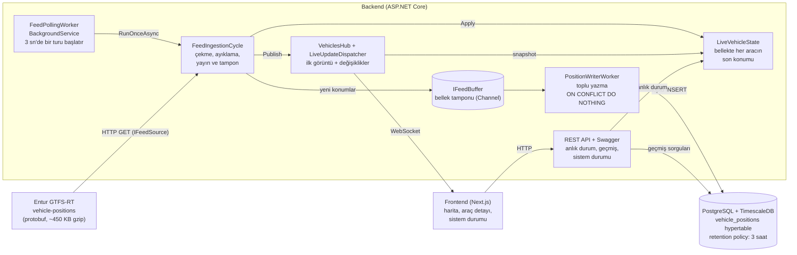

# Mimari ve Veri Akışı

## Bileşenler

## Bir konumun yolculuğu

1. **Çekme:** `FeedPollingWorker` açılışta ve `PeriodicTimer` ile her `PollInterval`'da (varsayılan 3 sn) `IFeedIngestionCycle.RunOnceAsync` çağırır. `FeedIngestionCycle`, `IFeedSource` üzerinden feed'i çeker (gzip). Worker yalnızca zamanlama ve beklenmeyen hataların loglanmasından sorumludur; kaynak hatasını sayıp turu atlayan `FeedIngestionCycle`'dır.
2. **Ayıklama:** Protobuf, Infrastructure katmanında kendi `VehiclePosition` tipimize çevrilir. `IFeedIngestor` uygulaması `FeedIngestor`, feed zamanı öncekinden yeni değilse turu atlar (gözlem: turların yarısı aynı, bazıları geri gidiyor). Yeniyse varlık başına daha önce görülenden yeni ve saklama penceresi içindeki ölçümler kalır. `Common/LatestByKey.cs` hem burada hem `LiveVehicleState`'te anahtar başına en yeni değeri tutar.
3. **Canlı yayın (DB'den bağımsız):** `FeedIngestionCycle` önce `ILiveVehicleStore` üzerinden `LiveVehicleState`'i günceller, sonra `ILiveUpdatePublisher` üzerinden yayınlar. `LiveUpdateDispatcher.Publish` güncellemeyi bir kez `LiveDtoUpdate`'e çevirip DTO'ları istemciler arasında paylaşır; gönderim döngüleri ayrıdır. Yeni istemcinin ilk görüntüsü ve REST yanıtı `LiveSnapshotMessage.From` ile üretilir. `GetSnapshot` sürüm değişmedikçe aynı snapshot'ı döndürür. Eski araç temizliği `Apply` içinde dakikada bir yapılır; yeni konum gelen normal akışta araç yaklaşık 1 dk fazla kalabilir, yeni konum gelmezse temizlik de bekler.
4. **Tampon:** `FeedIngestionCycle` yeni konumları `IFeedBuffer`'a koyar; canlı yayın hatası bu adımı engellemez. DB yavaş ya da kapalıysa burada bekler. Disk tamponu kapsam dışıdır; bellek tamponunun bilinen sınırları için bkz. [docs/known-limitations.md](known-limitations.md).
5. **Kalıcı yazma:** `PositionWriterWorker` tampondan toplu olarak okur, TimescaleDB'ye `ON CONFLICT DO NOTHING` ile yazar. Tekrar denemek güvenlidir, çift kayıt oluşmaz.
6. **Silme:** TimescaleDB'nin retention policy'si 3 saati geçen chunk'ları bütün olarak atar. Uygulama kodu silme yapmaz.

## Katmanlar

| Proje | Sorumluluk | Bağımlılık |
|---|---|---|
| `VehicleTracking.Domain` | `VehiclePosition` ve kuralları | hiçbir şey |
| `VehicleTracking.Application` | Arayüzler (`IFeedIngestionCycle`, `IFeedIngestor`, `IIngestionMetrics`, `ILiveVehicleStore`, `IHistoryQueryService`…), `FeedIngestionCycle`, `FeedIngestor`, `LiveVehicleState`, `IngestionMetrics`, `HistoryQueryService` + FluentValidation `HistoryQueryValidator`; `HistoryOptions` ile sorgu ayarları, `Common/UserMessages` ile kullanıcı metinleri | Domain |
| `VehicleTracking.Infrastructure` | Entur HTTP + protobuf, EF Core + TimescaleDB, toplu yazıcı, bellek tamponu | Application, Domain |
| `VehicleTracking.Api` | Host: REST (geçmişte `IHistoryQueryService` sonucunu HTTP'ye çevirir), SignalR (`ILiveConnectionRegistry` uygulaması `LiveUpdateDispatcher`), zamanlayıcı ve yazıcı worker, DI, Swagger | hepsi |

Protobuf tipleri Infrastructure dışına çıkmaz.
